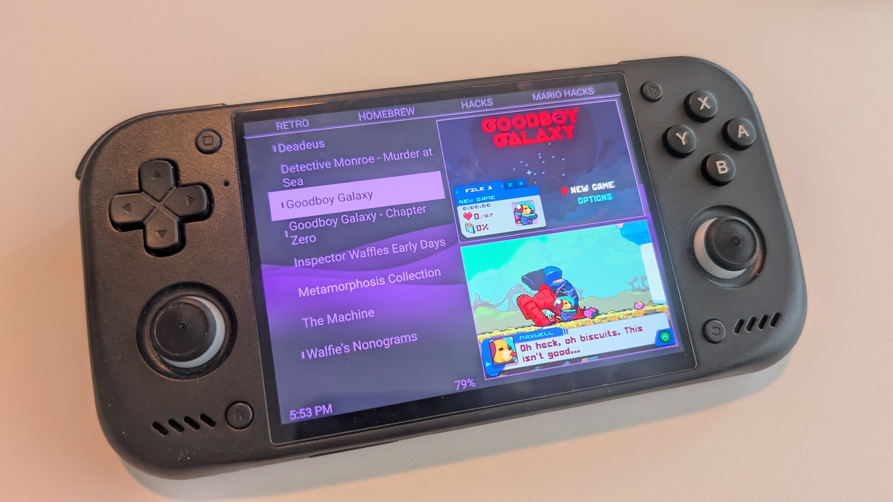
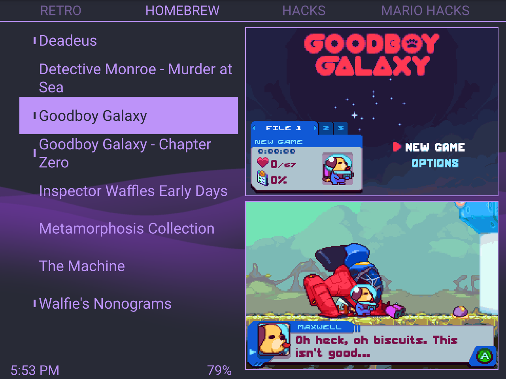
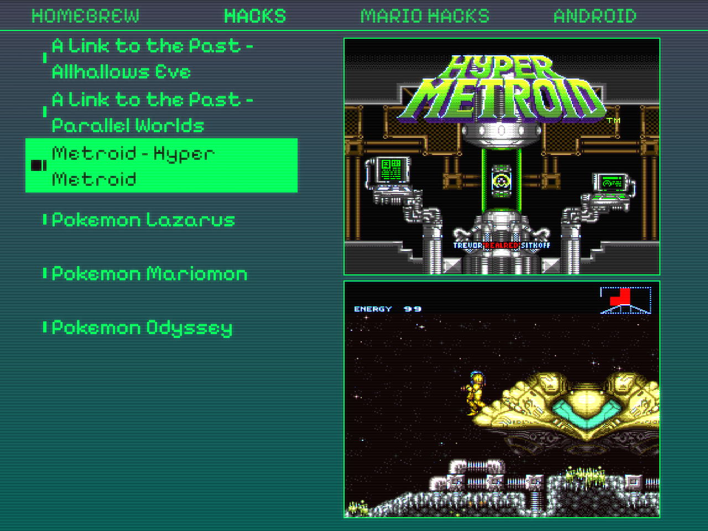
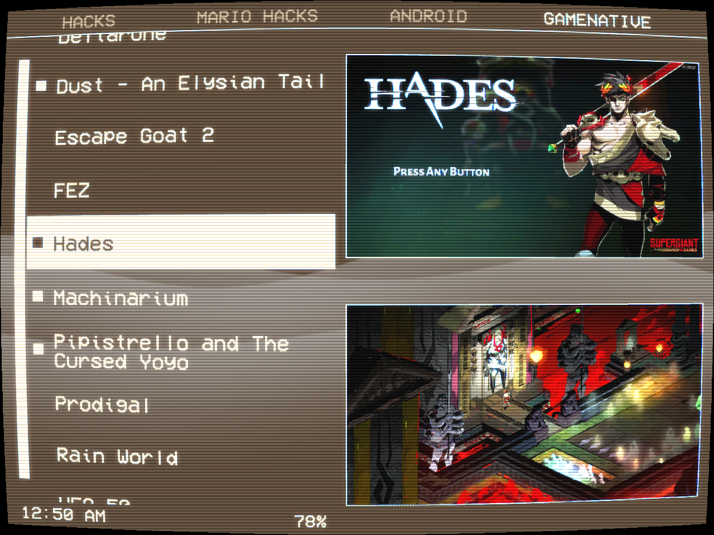
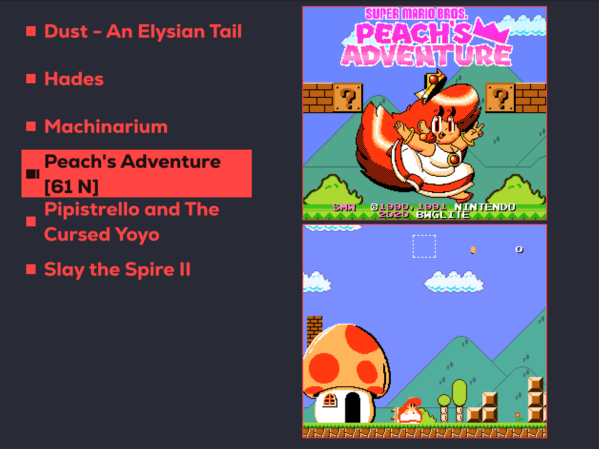
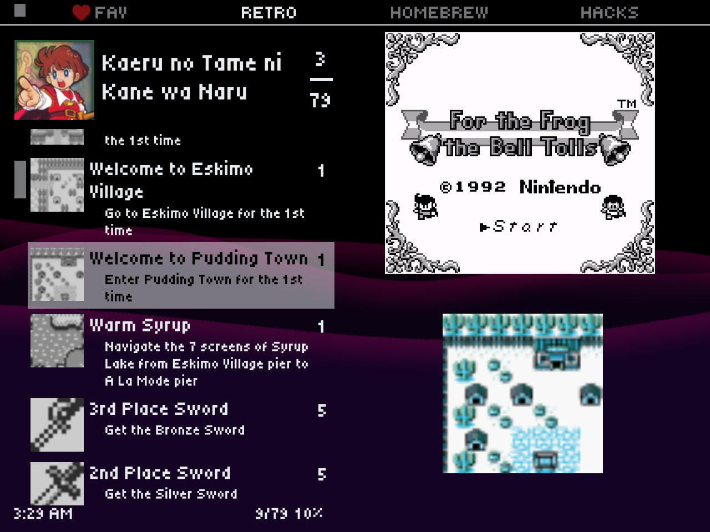
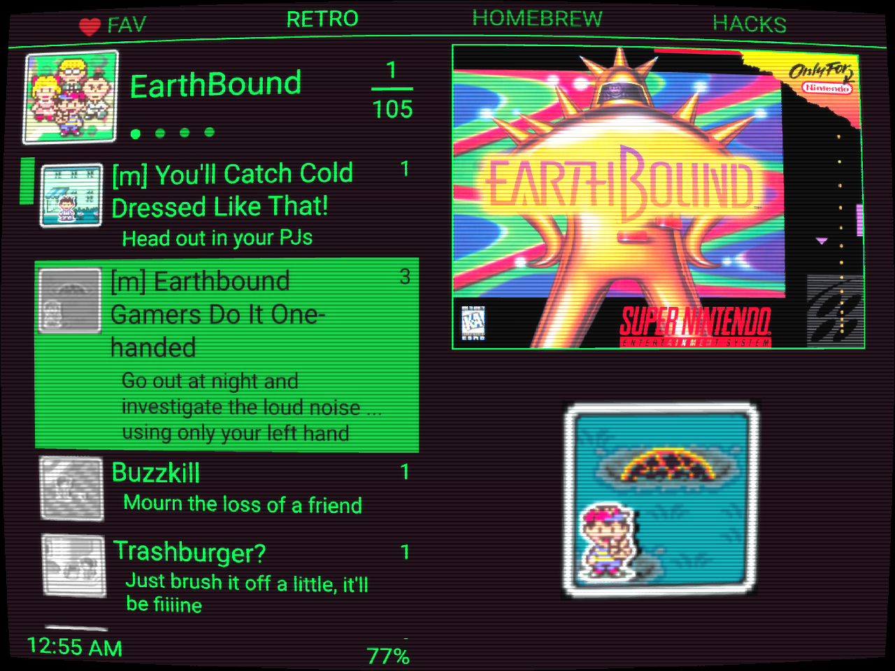
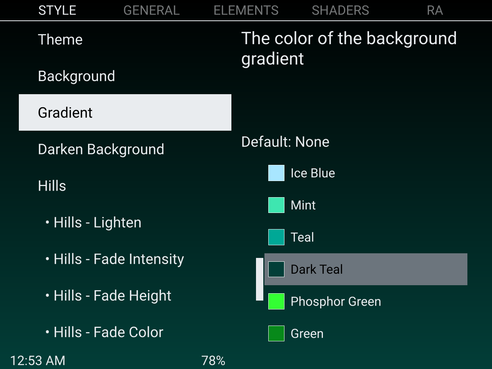

# Pegasus Boy Lite
Pegasus Boy Lite is a theme for [Pegasus Frontend](https://pegasus-frontend.org) based on [Pegaus Boy by gtaforever00](https://github.com/gtaforever00/pegasus-boy).  

Pegasus Boy Lite uses a minimal interface that prioritizes the game list and images with retroachievements support. It features extensive customization settings to tweak the layout, shader effects, and a hills background effect inspired by the psp.

## Installation
Download the [latest release](https://github.com/tap0119/PegasusBoyLite/releases), extract and place in the resulting folder your Pegasus theme directory. In Pegasus, select the theme in the settings menu.

## Features
- Minimal interface
- Favorites lock mode that only shows your favorite games for less distraction
- Retroachievements support
- Retroachievements caching to view achievements offline
- Settings to control the layout, colors and theme
- Toggleable clock, game counter, and battery
- Toggleable menu sounds
- Last Played Menu based on last played date
- Shaders providing a CRT look
- Hills background effect inspired by the PSP background

### Retroachievements
To use Retroachievements, enable Retroachievements in the settings, and input your RA username and API key. Your API key can be found at https://retroachievements.org/settings?tab=applications

To load achievements for a game on the Main List, press Page Down (L2) on a game. The theme will attempt to find the game system based on the shortname of the collection (such as NES, SNES etc). Then within the matched console it will look for a game matching the rom file name, ignoring, case, punctuation and (), []. The theme will also look for and load achievements subsets for a matched game. 

If the theme cannot find the system or a game that has retroachievements, you can create overrides for your collections or games in assets/AchievementsConfig.qml. Follow the intructions in that file, then restart Pegasus and try loading achievements again.

The theme will automatically cache loaded achievements for faster loading and viewing offline. If you accomplish any achievements offline such as with https://raofflineproxy.com, that won't be reflected in the theme till you connect to the internet again since the theme is querying the data from RA. You can delete cached achievement data in the settings.

## Controls
- Dpad              - Navigate
- (R1) Next Page    - Navigate to Settings and back
- - On the Retroachievements list, scroll down 10
- (L1) Prev Page    - On the Main List, jump to favorites collection and back
- - On the Settings page, go back to the Main List
- - On the Retroachievements list, scroll up 10
- (L2) Page Down    - Open/Close Retroachievements for the current game

- (A) Accept        - Launch Game
- (B) Back          - Enlarge images
- (X) Game Details  - On the Main List switch between the Title screen/Box Art and Screenshot/Background images 
- - On the Retroachievements list, show the current achievement badge on the right side
- (Y) Filter        - Favorite game

## Assets
This theme is designed to use the following assets. To get the most out of this theme, it is reccomended you have a screenshot, and at least one of the titlescreen or boxart for each game. 

- Titlescreen
- Boxfront
- Screenshot
- Background

For information on assets see [Assets in the Pegasus Docs](https://pegasus-frontend.org/docs/user-guide/meta-assets/)

## Screenshots

### Favorites Lock mode only showing favorite games

### Retroachievements Support

### Settings Menu

## License
Distributed under the GNU General Public License v3.0+. See [COPYING](COPYING) for more information.

## Acknowledgements
- Forked from [Pegaus Boy by gtaforever00](https://github.com/gtaforever00/pegasus-boy)
- [Pegasus](https://pegasus-frontend.org/)
- [Libretro shaders](https://github.com/libretro/slang-shaders)
- Hills background effect adapted from [Pegasus Beacon Lite Theme](https://github.com/ZagonAb/pegasus-beacon-lite)

AI disclosure: LLMs including Claude were used to aid development of some features including handling Retroachivements and shader and hill effects. All code was reviewed and tested by me before being integrated into the project. 

